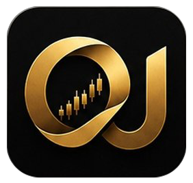
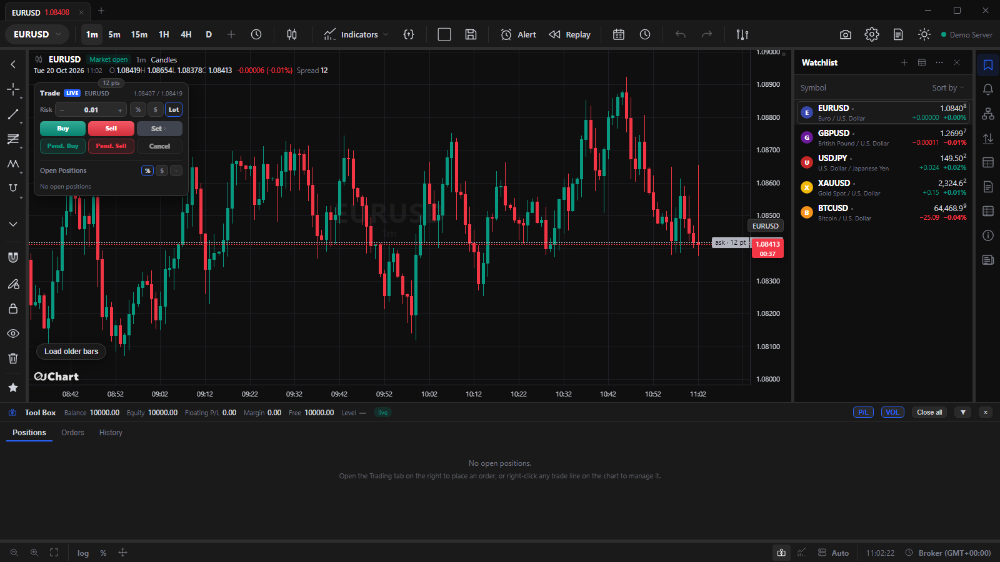
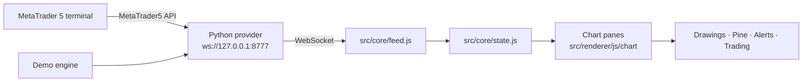

<div align="center">



# OJchart

**Professional charting for MetaTrader 5 — fast, local, and yours.**
**چارت حرفه‌ای برای متاتریدر ۵ — سریع، محلی و مال خودت.**

[](package.json)
[](#-requirements)
[](package.json)
[](package.json)
[](provider/requirements.txt)
[](LICENSE)

[English](#english) · [فارسی](#فارسی)



</div>

---

## English

> **Status:** pre-release `1.9.x`. The Windows build is the primary target; macOS/Linux currently run demo mode.

**OJchart** is a lightweight TradingView-style charting terminal built with **Electron** and a **Python WebSocket provider**. It renders live MetaTrader 5 data or a fully local simulated feed, with drawing tools, Pine Script v6, alerts, news, replay and a complete trading stack.

### ✨ Highlights

| | |
|---|---|
| 📊 **Charting** | Seconds-to-months timeframes, 11 chart styles, 55 multi-chart layouts, per-pane resizing, snapshots |
| ✏️ **Drawing** | Full TradingView-style toolbar: trend lines, channels, Fibonacci/Gann, pitchforks, text, measure, magnets |
| 🧠 **Pine Script v6** | Built-in editor and runtime, custom indicators, sub-panes, boxes/lines/labels owned by scripts |
| 🔔 **Alerts & news** | Five price conditions with notifications and sound, economic calendar with impact/currency filters |
| 💼 **Trading** | Order ticket, one-click, SL/TP, partial close, pending orders, strategy tester, bar replay |
| 🎞️ **Workspace** | Saved layouts, autosave, watchlists, per-chart styles, timezone picker, CSV export |
| 🔐 **Private by design** | Local storage only, OS-encrypted credentials, strict CSP, sandboxed renderer, redacted logs |

### 📦 Requirements

- **Windows 10/11** — primary target; real MT5 data needs the Windows-only `MetaTrader5` package.
- **macOS / Linux** — demo mode via `run.sh`; real MT5 data still requires Windows.
- **Node.js 20+** (CI uses 22) and **Python 3.8+** (`python`, `python3` or `py -3` in `PATH`).
- Provider dependencies:

```bash
python -m pip install -r provider/requirements.txt   # websockets
python -m pip install MetaTrader5                    # real MT5 data only
```

### 🚀 Run from source

```bash
npm install
npm start            # Windows: run-demo.bat / run-mt5.bat also work
```

1. On the login screen choose **Demo Server** (instant simulated market) or **MetaTrader 5** (login, password, server, optional terminal path).
2. **Linux sandbox note:** if Chromium's SUID sandbox is blocked (Ubuntu 22.04+/24.04 AppArmor, Docker, WSL), use `./run.sh --no-sandbox`. Only on machines you trust.
3. The first launch downloads Electron through the npmmirror mirror and verifies it against the official checksum (`scripts/verify-electron.js`).

### 🏗️ Build an installer

`electron-builder` is configured in `package.json`:

```bash
npm run dist:win     # dist/OJchart Setup <version>.exe   (NSIS)
npm run dist:mac     # dist/OJchart.dmg
npm run dist:linux   # dist/OJchart.AppImage
```

Builds are **unsigned** by default — Windows SmartScreen / macOS Gatekeeper will warn on first run. For distribution, provide a certificate through `CSC_LINK` / `CSC_KEY_PASSWORD` (see [Code signing](#-code-signing)); macOS notarization additionally reads `APPLE_ID`, `APPLE_APP_SPECIFIC_PASSWORD` and `APPLE_TEAM_ID`.

The Python provider ships **outside** the asar archive (`build.asarUnpack`): Python cannot read `app.asar`, so keep that entry when editing the bundler config — otherwise the installed app boots but the provider never starts.

### 🧭 Architecture



- **`src/core/`** — platform-agnostic layer (env, util, logger, errors, indicators, state, timezone, feed, demo-math, session-math + the Pine engine). No `window`/`document`/`electronAPI` references; the only host seam is `core/env.js`.
- **`src/platform/electron/`** — Electron host adapters (log transport, Python detection, provider paths).
- **`src/renderer/`** — the DOM app with a single ES-module entry, `js/app.js`; every cross-file reference is a named import/export.
- **`provider/`** — Python WebSocket servers (`demo.py`, `mt5.py`) sharing `provider_common.py`.
- Data flow: `provider/*.py` → `src/core/feed.js` → `src/core/state.js` → chart panes. Details in [`docs/ARCHITECTURE.md`](docs/ARCHITECTURE.md).

### ✅ Testing & CI

`npm run verify` (= `npm test`) is the quality gate:

1. **`check:syntax`** — parses every `.js`/`.mjs` file as an ES module.
2. **`check:imports`** — resolves every relative import/export to a real file.
3. **`check:py`** — byte-compiles all `provider/*.py`.
4. **`smoke`** — boots `provider/demo.py`, serves `src/`, logs into the demo server in a hidden **offscreen Electron** window and asserts app visible, login hidden, bars loaded, canvases present, zero console errors and zero failed requests.

CI (`.github/workflows/ci.yml`) runs the full gate on Windows and the static gates on Linux for every push and pull request.

### 🔐 Security & privacy

- Credentials never enter `localStorage`: MT5 accounts go through the `accounts-save` IPC and are encrypted with OS `safeStorage` (DPAPI on Windows).
- Strict CSP, sandboxed renderer, validated IPC payloads, all web permissions denied.
- Log contexts are auto-redacted (`password`, `token`, … never reach the log).
- Details: [`docs/SECURITY-ROUND81.md`](docs/SECURITY-ROUND81.md).

### 🩺 Diagnostics

- **In-app panel:** right rail → info icon. Live logs with filters, session stats, export to `.log`/`.json`, and a self-test.
- **File logs:** `%APPDATA%/mt5-chart-terminal/logs/app-YYYY-MM-DD.log` on Windows (JSONL, ~2 MB rotation, 7-day retention).
- Provider crash log: `%TEMP%\mt5_provider_crash.log`.

### 🛠️ Troubleshooting

| Symptom | Fix |
|---|---|
| Window opens, never connects | `python -m pip install -r provider/requirements.txt`; make sure port **8777** is free |
| `Python 3 not found` | Install Python 3.8+ and tick “Add python.exe to PATH” (or install the `py` launcher) |
| Blank screen after an update | Run `npm run verify` — it separates syntax/import/provider failures from UI failures |
| Linux sandbox error | `./run.sh --no-sandbox` (trusted machines only) |

### 🔏 Code signing

electron-builder reads signing material from the environment; nothing is stored in the repository.

| Variable | Meaning |
|---|---|
| `CSC_LINK` | Path to `.pfx`/`.p12`, an `https://` URL, or a base64 certificate |
| `CSC_KEY_PASSWORD` | Certificate password |

```powershell
$env:CSC_LINK = 'C:\certs\ojchart.pfx'
$env:CSC_KEY_PASSWORD = 'the-certificate-password'
npm run dist:win
```

```bash
export CSC_LINK=/secure/ojchart.p12
export CSC_KEY_PASSWORD='the-certificate-password'
npm run dist:mac
```

**Never commit certificates, passwords or key material.** `.gitignore` excludes `*.pfx`, `*.p12`, `*.cer`, `*.key` and `*.pem`.

### 🚢 Release checklist

```bash
node scripts/release.mjs --dry-run         # print the plan, write nothing
node scripts/release.mjs                   # patch bump
node scripts/release.mjs --bump minor      # 1.9.212 -> 1.10.0
node scripts/release.mjs --version 2.0.0   # explicit version
node scripts/release.mjs --message "Fix login retry"
```

The script refuses a dirty tree (override: `--allow-dirty`) or an existing tag, runs `npm run verify` (skip: `--no-verify`), then bumps `package.json` + `src/core/logger.js`, updates the split changelog and index, commits `Release x.y.z`, tags `vx.y.z` and builds the platform installer (`--no-build` stops after the tag). Alias: `npm run release -- --bump minor`.

### 📚 Documentation

- [`docs/ARCHITECTURE.md`](docs/ARCHITECTURE.md) — module boundaries and data flow
- [`docs/README.md`](docs/README.md) — documentation index (living docs + archive)
- [`docs/PINE-ENGINE-PLAN.md`](docs/PINE-ENGINE-PLAN.md) — Pine Script v6 engine
- [`docs/HANDOFF-ROADMAP.md`](docs/HANDOFF-ROADMAP.md) — engineering roadmap
- [`CHANGELOG.md`](CHANGELOG.md) — release history by major line

### ⚖️ Disclaimer

OJchart is an independent project. It is **not affiliated with, endorsed by, or connected to** TradingView, MetaQuotes or any broker. “MetaTrader” and “TradingView” are trademarks of their respective owners. Trading involves risk; this software is provided “as is” under the MIT license.

---

<div align="right" dir="rtl">

## فارسی

> **وضعیت:** پیش‌انتشار `1.9.x`. هدف اصلی ویندوز است؛ macOS و لینوکس فعلاً فقط حالت دمو را اجرا می‌کنند.

**OJchart** یک ترمینال چارت‌ینگ سبک با ظاهر TradingView است که با **Electron** و یک **پرووایدر WebSocket پایتون** ساخته شده. داده‌ی زنده‌ی متاتریدر ۵ یا فید شبیه‌سازی‌شده‌ی کاملاً محلی را رسم می‌کند و ابزار ترسیم، Pine Script v6، هشدارها، اخبار، ریپلی و مجموعه‌ی کامل معاملات را در اختیار می‌گذارد.

### ✨ نگاه کلی

| | |
|---|---|
| 📊 **چارت** | تایم‌فریم ثانیه تا ماه، ۱۱ سبک چارت، ۵۵ چیدمان چندچارت‌ی، تغییر اندازه‌ی مستقل هر پنل، اسکرین‌شات |
| ✏️ **ترسیم** | نوار ابزار کامل TradingView: خط روند، کانال، فیبوناچی/گان، پیچ‌فورک، متن، اندازه‌گیری، مگنت |
| 🧠 **Pine Script v6** | ادیتور و رانتایم داخلی، اندیکاتور سفارشی، زیرپنل، باکس/خط/لیبل متعلق به اسکریپت |
| 🔔 **هشدار و اخبار** | پنج شرط قیمتی با نوتیفیکیشن و صدا، تقویم اقتصادی با فیلتر اهمیت/ارز |
| 💼 **معاملات** | تیکت سفارش، یک‌کلیکی، SL/TP، بستن جزئی، سفارش‌های معلق، استراتژی‌تستر، ریپلی |
| 🎞️ **فضای کاری** | چیدمان‌های ذخیره‌شده، ذخیره‌ی خودکار، واچ‌لیست، سبک هر چارت، انتخاب تایم‌زون، خروجی CSV |
| 🔐 **حریم خصوصی** | ذخیره‌سازی فقط محلی، رمزنگاری اعتبارنامه با OS، CSP سخت‌گیرانه، رندرر sandbox، لاگ‌های پاک‌سازی‌شده |

### 📦 پیش‌نیازها

- **ویندوز ۱۰/۱۱** — هدف اصلی؛ داده‌ی واقعی MT5 به پکیج ویندوزی `MetaTrader5` نیاز دارد.
- **macOS / لینوکس** — حالت دمو با `run.sh`؛ داده‌ی واقعی MT5 همچنان فقط ویندوز.
- **Node.js 20+** (CI روی ۲۲) و **Python 3.8+** (`python`، `python3` یا `py -3` در `PATH`).
- وابستگی پرووایدر:

```bash
python -m pip install -r provider/requirements.txt   # websockets
python -m pip install MetaTrader5                    # فقط برای داده‌ی واقعی MT5
```

### 🚀 اجرا از سورس

```bash
npm install
npm start            # در ویندوز: run-demo.bat یا run-mt5.bat هم کار می‌کند
```

۱. در صفحه‌ی ورود **Demo Server** (بازار شبیه‌سازی‌شده) یا **MetaTrader 5** (لاگین، رمز، سرور و مسیر اختیاری ترمینال) را انتخاب کن.
۲. **نکته‌ی sandbox لینوکس:** اگر sandbox کرومیوم بلاک شده باشد (Ubuntu 22.04+/24.04 با AppArmor، داکر، WSL) از `./run.sh --no-sandbox` استفاده کن؛ فقط روی ماشینی که به آن اعتماد داری.
۳. اجرای اول Electron را از میرور npmmirror دانلود و با checksum رسمی تأیید می‌کند (`scripts/verify-electron.js`).

### 🏗️ ساخت نصب‌کننده

```bash
npm run dist:win     # dist/OJchart Setup <version>.exe   (NSIS)
npm run dist:mac     # dist/OJchart.dmg
npm run dist:linux   # dist/OJchart.AppImage
```

بیلدها به‌صورت پیش‌فرض **امضا نشده‌اند** — ویندوز SmartScreen و macOS Gatekeeper در اجرای اول هشدار می‌دهند. برای توزیع واقعی، گواهی را با `CSC_LINK` / `CSC_KEY_PASSWORD` بده (بخش [امضای کد](#-امضای-کد)). برای notarization مک علاوه بر این `APPLE_ID`، `APPLE_APP_SPECIFIC_PASSWORD` و `APPLE_TEAM_ID` لازم است.

پرووایدر پایتون **بیرون** از آرشیو asar قرار می‌گیرد (`build.asarUnpack`): پایتون نمی‌تواند داخل `app.asar` را بخواند. اگر تنظیمات باندلر را عوض کردی این گزینه را نگه دار، وگرنه اپ نصب می‌شود ولی پرووایدر بالا نمی‌آید.

### 🧭 معماری

- **`src/core/`** — لایه‌ی مستقل از پلتفرم (env، util، logger، errors، indicators، state، timezone، feed، demo-math، session-math و موتور Pine). هیچ ارجاعی به `window`/`document`/`electronAPI` ندارد؛ تنها اتصال میزبان `core/env.js` است.
- **`src/platform/electron/`** — آداپتورهای میزبان Electron (انتقال لاگ، تشخیص پایتون، مسیر پرووایدر).
- **`src/renderer/`** — اپ DOM با یک entry ماژول ES به نام `js/app.js`؛ همه‌ی ارجاعات بین‌فایلی import/export نام‌دار هستند.
- **`provider/`** — سرورهای WebSocket پایتون (`demo.py`، `mt5.py`) با `provider_common.py` مشترک.
- جریان داده: `provider/*.py` → `src/core/feed.js` → `src/core/state.js` → پنل‌های چارت. جزئیات: [`docs/ARCHITECTURE.md`](docs/ARCHITECTURE.md).

### ✅ تست و CI

`npm run verify` (برابر با `npm test`) دروازه‌ی کیفیت است:

۱. **`check:syntax`** — پارس همه‌ی فایل‌های `.js`/`.mjs` به‌عنوان ماژول ES.
۲. **`check:imports`** — حل شدن همه‌ی import/exportهای نسبی به فایل واقعی.
۳. **`check:py`** — کامپایل همه‌ی `provider/*.py`.
۴. **`smoke`** — اجرای `provider/demo.py`، سرو `src/`، ورود دمو در یک پنجره‌ی **Electron آفسکرین** و بررسی: اپ دیده شود، لاگین مخفی، کندل‌ها لود شوند، canvas موجود باشد، صفر خطای کنسول و صفر درخواست ناموفق.

CI (`.github/workflows/ci.yml`) برای هر push و pull request کل گیت را روی ویندوز و گیت‌های استاتیک را روی لینوکس اجرا می‌کند.

### 🔐 امنیت و حریم خصوصی

- اعتبارنامه‌ها هرگز در `localStorage` نیستند: اکانت‌های MT5 از مسیر IPC `accounts-save` می‌روند و با `safeStorage` سیستم‌عامل (DPAPI در ویندوز) رمز می‌شوند.
- CSP سخت‌گیرانه، رندرر sandbox، اعتبارسنجی همه‌ی پیام‌های IPC و رد کردن همه‌ی مجوزهای وب.
- کانتکست لاگ‌ها خودکار پاک‌سازی می‌شود (`password`، `token` و مشابه آن هرگز ثبت نمی‌شوند).
- جزئیات: [`docs/SECURITY-ROUND81.md`](docs/SECURITY-ROUND81.md).

### 🩺 عیب‌یابی و لاگ

- **پنل داخلی:** ریل راست → آیکون info. لاگ زنده با فیلتر، آمار نشست، خروجی `.log`/`.json` و خودآزمایی.
- **فایل لاگ:** در ویندوز `%APPDATA%/mt5-chart-terminal/logs/app-YYYY-MM-DD.log` (JSONL، چرخش ~۲ مگابایت، نگهداری ۷ روز).
- لاگ کرش پرووایدر: `%TEMP%\mt5_provider_crash.log`.

| مشکل | راه‌حل |
|---|---|
| پنجره باز می‌شود ولی وصل نمی‌شود | `python -m pip install -r provider/requirements.txt` و آزاد بودن پورت **8777** |
| `Python 3 not found` | نصب Python 3.8+ با تیک «Add python.exe to PATH» یا نصب لانچر `py` |
| صفحه‌ی سفید بعد از آپدیت | `npm run verify` — خطای syntax/import/provider را از خطای UI جدا می‌کند |
| خطای sandbox لینوکس | `./run.sh --no-sandbox` (فقط ماشین مورد اعتماد) |

### 🔏 امضای کد

electron-builder مواد امضا را از محیط می‌خواند؛ چیزی در مخزن ذخیره نمی‌شود.

| متغیر | معنی |
|---|---|
| `CSC_LINK` | مسیر `.pfx`/`.p12`، آدرس `https://` یا گواهی base64 |
| `CSC_KEY_PASSWORD` | رمز گواهی |

```powershell
$env:CSC_LINK = 'C:\certs\ojchart.pfx'
$env:CSC_KEY_PASSWORD = 'the-certificate-password'
npm run dist:win
```

```bash
export CSC_LINK=/secure/ojchart.p12
export CSC_KEY_PASSWORD='the-certificate-password'
npm run dist:mac
```

**هرگز گواهی، رمز یا کلید را کامیت نکن.** `.gitignore` پسوندهای `*.pfx`، `*.p12`، `*.cer`، `*.key` و `*.pem` را مستثنا می‌کند.

### 🚢 چک‌لیست انتشار

```bash
node scripts/release.mjs --dry-run         # فقط نمایش برنامه
node scripts/release.mjs                   # افزایش patch
node scripts/release.mjs --bump minor      # 1.9.212 -> 1.10.0
node scripts/release.mjs --version 2.0.0   # نسخه‌ی صریح
node scripts/release.mjs --message "Fix login retry"
```

اسکریپت روی tree کثیف (مگر `--allow-dirty`) یا تگ موجود اجرا نمی‌شود، `npm run verify` را اجرا می‌کند (مگر `--no-verify`)، نسخه را در `package.json` و `src/core/logger.js` می‌نویسد، چنج‌لاگ و ایندکس را به‌روز می‌کند، کامیت `Release x.y.z` و تگ `vx.y.z` می‌سازد و نصب‌کننده‌ی همان پلتفرم را بیلد می‌کند (`--no-build` بعد از تگ متوقف می‌شود). معادل npm: `npm run release -- --bump minor`.

### 📚 مستندات

- [`docs/ARCHITECTURE.md`](docs/ARCHITECTURE.md) — مرز ماژول‌ها و جریان داده
- [`docs/PINE-ENGINE-PLAN.md`](docs/PINE-ENGINE-PLAN.md) — موتور Pine Script v6
- [`docs/HANDOFF-ROADMAP.md`](docs/HANDOFF-ROADMAP.md) — نقشه‌راه مهندسی
- [`CHANGELOG.md`](CHANGELOG.md) — تاریخچه‌ی انتشار

### ⚖️ سلب مسئولیت

OJchart یک پروژه‌ی مستقل است و **هیچ وابستگی، تأیید یا ارتباطی** با TradingView، MetaQuotes یا هیچ کارگزاری ندارد. «MetaTrader» و «TradingView» علائم تجاری صاحبانشان هستند. معامله ریسک دارد؛ این نرم‌افزار «همان‌گونه که هست» و تحت مجوز MIT ارائه می‌شود.

</div>

---

<div align="center">

**© 2026 AHNesari · OJchart**

</div>
